# Aikido Endpoint Protection: hands-on look, 2026-11-12

Aikido Endpoint Protection 1.10.33 (the "Device Protection" product named as the
closest competitor in [issue #149](https://github.com/allayhq/Allay/issues/149))
was installed in a throwaway macOS 26.6.2 VM and driven through its GUI and CLI.
This note records what the app shows, how little UI it has, how that compares
with Allay, and what it implies for the plan in #149.

**Bottom line.** Aikido ships a much wider install gate than Allay behind a far
smaller UI: three tabs, one status pill, no local settings. It does nothing for
#149's other five layers on the device, as far as this test could see. Its
costs are a required account token, system-wide TLS interception, and block
messages that tell the user almost nothing.

## How this was tested

| Item | Value |
| --- | --- |
| Package | `EndpointProtection-1.10.33.pkg`, signed and notarized by Aikido Security (7VPF8GD6J4) |
| Guest | macOS 26.6.2 on Tart, image `ghcr.io/cirruslabs/macos-tahoe-base`, 4 CPU, 8 GB |
| Enrollment | Token staged in `/tmp/aikido_endpoint_token.txt`; server accepted it on first heartbeat |
| GUI capture | VNC over SSH into the guest; no host input events |

Limits of this test:

- **SIP is disabled** in the Cirrus Labs image. Enforcement behaviour on a stock Mac may differ.
- **The setup wizard was not captured.** It was completed by hand before screenshots started. Its step names come from the daemon log.
- **The cloud dashboard was not opened.** Everything below is the device side only.
- **Only npm was exercised.** Extension, browser, PyPI and other ecosystems were not triggered.
- **Two feature flags were off** for this account: `AiFeaturesEnabled` and `EnableSecretScanning`.
- Guest DNS had to be pointed at 1.1.1.1; the host's VM DNS forwarder did not answer. Not an Aikido issue.

## What the app looks like

The whole GUI is one window with three tabs, a menu bar icon with two items,
and one notification style.

### Window

| Tab | Contents |
| --- | --- |
| Events | Search box, filter button, table of Time / package / Status. Empty state is one sentence. |
| Ecosystems | Read-only list of 15 covered ecosystems; seven have a "Test" button that shows a command to copy. |
| Help | Two doc links, "Report A Problem", "Contact Support", SSL-error and uninstall links. |

The header carries the logo, a green "Protected" pill and the version. There is
no settings page, no toggle, no pause button, no policy view and no account
screen anywhere in the app.


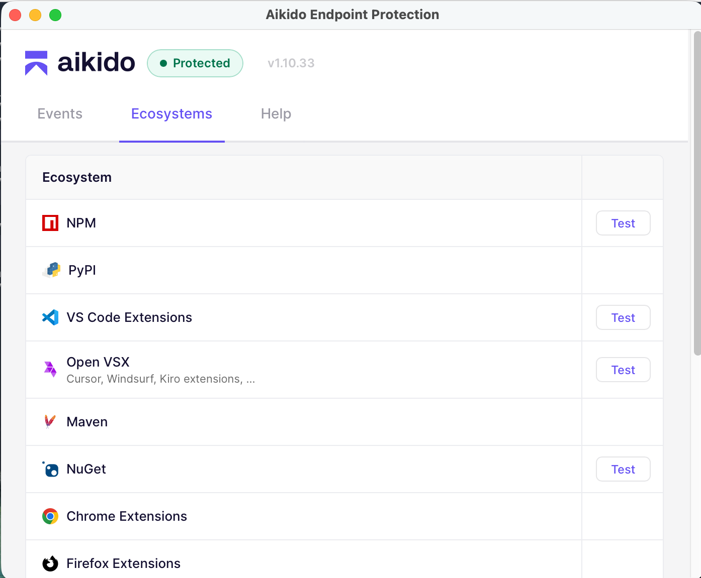


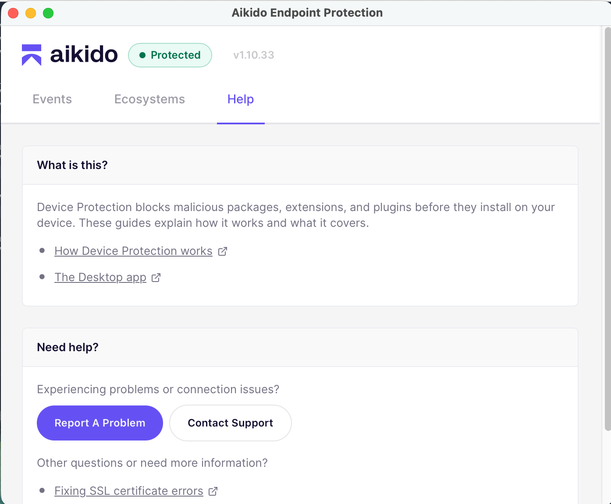


Ecosystems listed: NPM, PyPI, VS Code Extensions, Open VSX (Cursor, Windsurf,
Kiro), Maven, NuGet, Chrome Extensions, Firefox Extensions, Golang, Skills.sh,
RubyGems, Cargo, Packagist, JetBrains Plugins, Homebrew.

### Menu bar

Two items: a status line ("Aikido Proxy: connected") and "Open Dashboard".

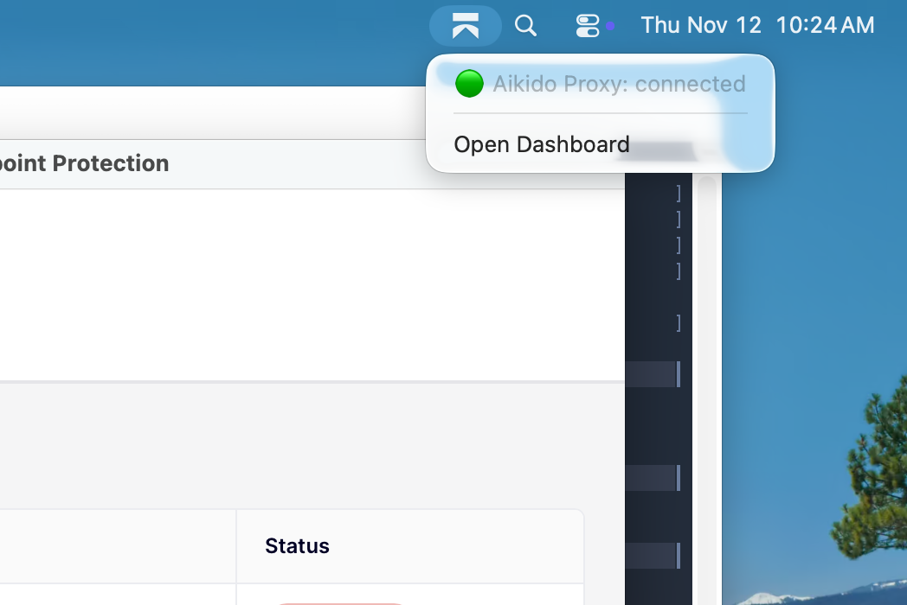

### A block, end to end

The NPM "Test" button shows `npm install aikido-endpoint-test`.


Running it produced three things:

1. npm failed with `403 Forbidden` on the tarball URL and npm's generic "forbidden by your security policy" text. Nothing in the terminal names Aikido.
2. A floating "INSTALL BLOCKED" card appeared top-right with the package name, a "Malware" tag, and Dismiss / View Details. It disappeared by itself within about ten seconds.
3. A row appeared in Events.


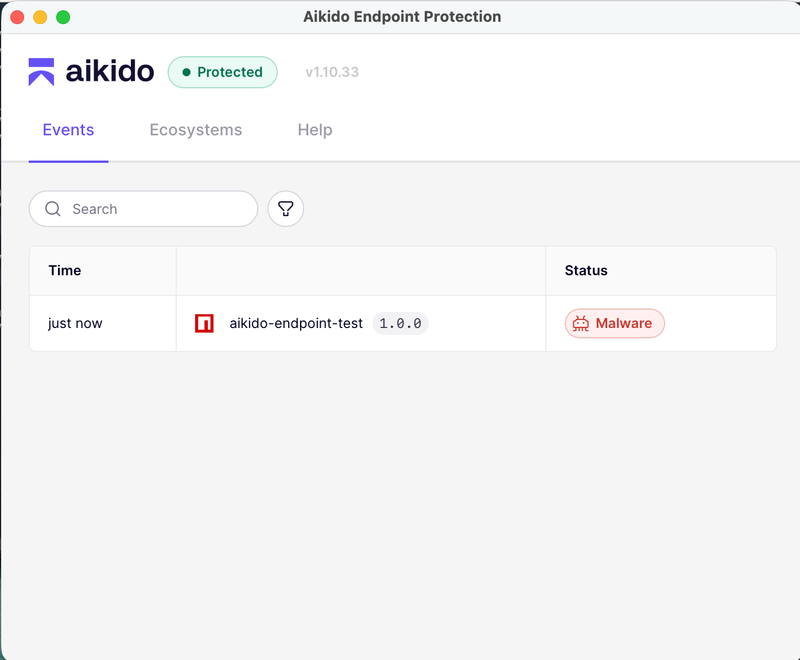

The detail view holds one sentence, the package and version, and an
"Application" field that reads `node-555549440a36…`: a binary hash, not the
terminal, agent or command that started the install.

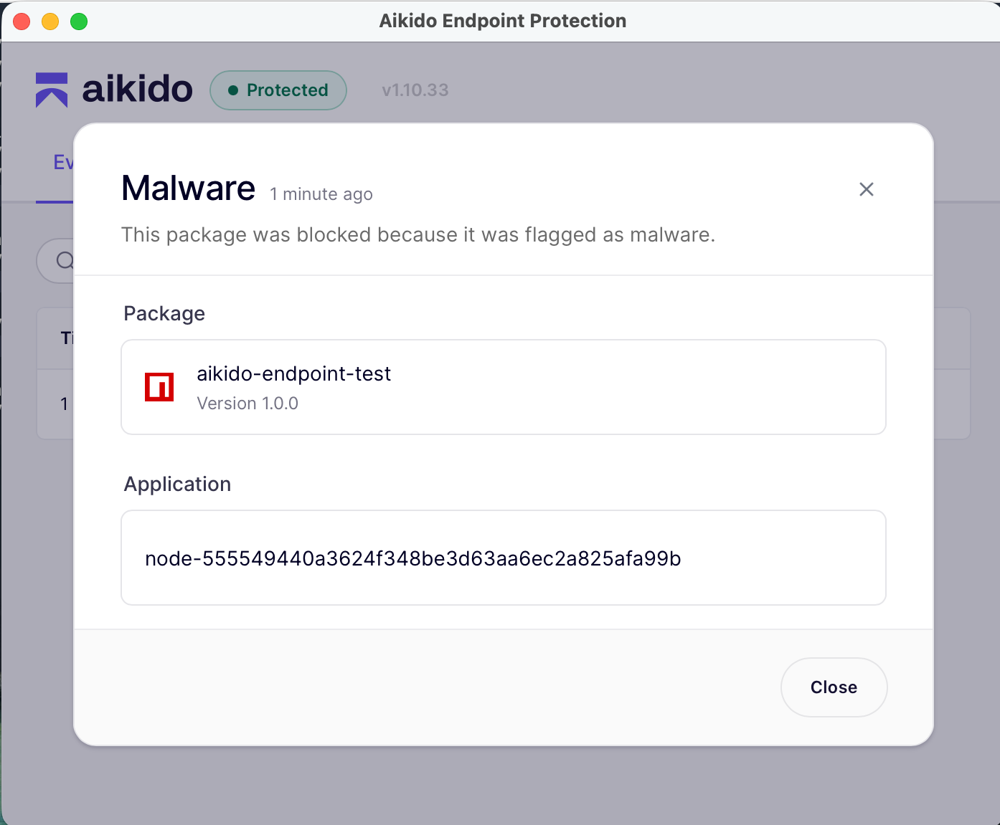

The filter has quick filters for "Request Sent", "Request Approved" and
"Malware", plus status and ecosystem pickers. The first two belong to a flow
where a blocked user asks an admin for approval (`aikido-doctor request`).


### A minimum-age suppression, and a rough edge

The Skills.sh "Test" button shows `npx skills add Aikido-demo-apps/demo-endpoint-skills`.


Running it did not reach the skill check. npm failed first:

```
npm error code ETARGET
npm error notarget No matching version found for skills@1.8.1.
```

Aikido had hidden `skills` 1.8.0 and 1.8.1 under its minimum package age
policy, so `npm view skills` reported 1.7.6 as latest while npx still asked for
1.8.1. No notification was shown. The only trace is a grey "Versions
Suppressed" row in Events, and `aikido-doctor events` does not list it.

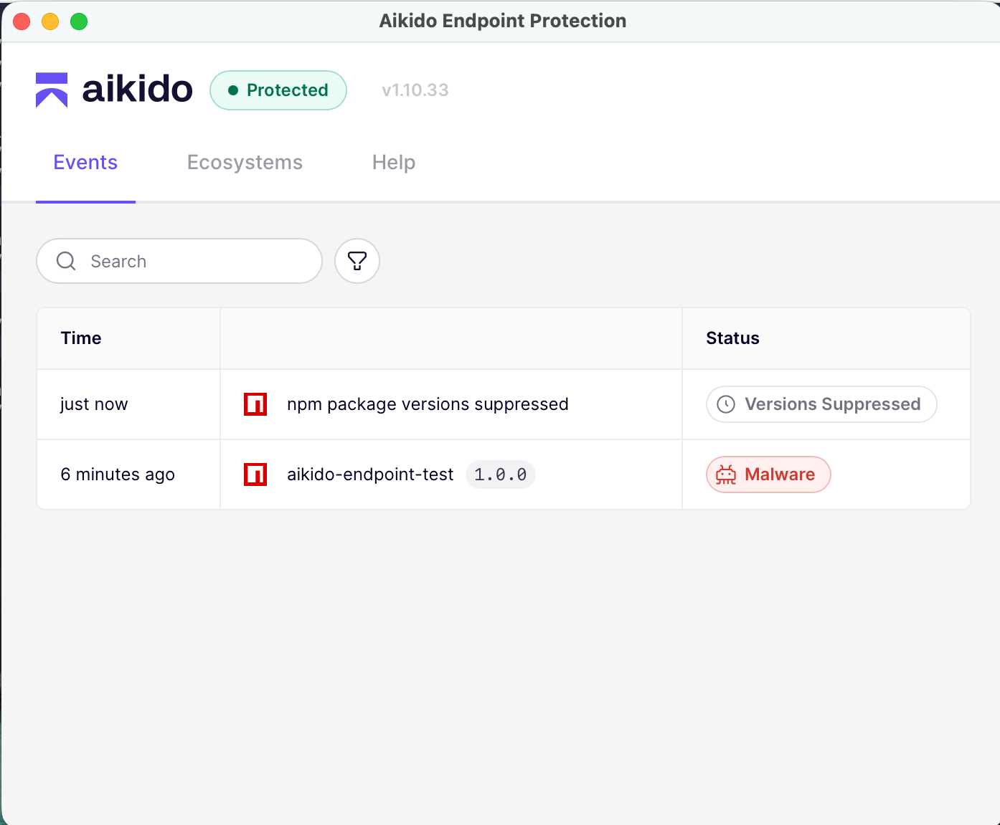

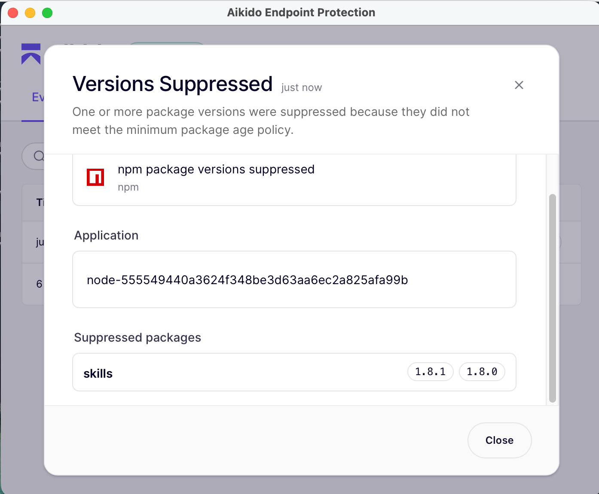

So the product's own test command for agent skills was broken by its own
release-age rule, with an npm error that does not mention Aikido. The age
threshold is not shown anywhere in the app.

## What sits under the small UI

Observed in the guest:

- **System-wide interception.** A network system extension diverts traffic for 12 registry hosts (`registry.npmjs.org`, `pypi.org`, `files.pythonhosted.org`, `crates.io`, `index.crates.io`, `rubygems.org`, `proxy.golang.org`, `repo1.maven.org`, `api.nuget.org`, `repo.packagist.org`, `marketplace.visualstudio.com`, `open-vsx.org`) to a local TLS-inspecting proxy. No per-package-manager routing is needed.
- **Its own CA, pushed into every toolchain.** It installs a CA in the system keychain and maintains 18 "certconfig" rules (node, npm, pip, uv, git, curl, ruby, cargo, java, homebrew, Firefox, Chromium and others) with automatic drift repair.
- **Edits to user dotfiles.** It appended CA environment variables (`SSL_CERT_FILE`, `CURL_CA_BUNDLE`, `PIP_CERT`, `REQUESTS_CA_BUNDLE` and more) to `~/.zshrc` and `~/.zprofile`, set `http.sslCAInfo` in `~/.gitconfig`, and wrote `~/.config/pip/pip.conf`. Backups are left as `*.aikido-backup`.
- **Reporting to Aikido.** Heartbeats include hostname, serial number, MAC address, user name and whether the user is an admin. A software inventory (Homebrew, npm and others) is collected and, per the CLI help, submitted to Aikido.
- **Footprint.** About 540 MB on disk. Resident memory: network extension 230 to 470 MB, UI 120 MB, daemon 40 MB.
- **A second extension** (Endpoint Security) is in the package but was not active; only the network extension was loaded.

Controls that exist only outside the GUI (`aikido-doctor`, see
[aikido-doctor-help.txt](aikido-doctor-help.txt)):

- `status` prints a clear "Protected / Not protected" checklist with the exact missing setup step.
- `pause --hours N` pauses protection; there is no pause in the app.
- `request` lists blocked packages and asks an admin to approve them. There is no local allow.
- `lockdown release` refers to a network lockdown an admin can trigger from the dashboard.
- `secretscanning` scans shell history with 463 rules and can rewrite history files; disabled by flag here.
- `sbom generate`, `certconfig`, `certs`, `diagnostics`, `device-identity`, `token`.

Inferred, not verified: strings in the daemon binary name collectors for Claude
Code, Claude Desktop, Codex and Cursor, and MCP server config. This suggests it
inventories agent installs and MCP servers for the dashboard. No such data
appeared in the device UI.

## How minimal it is, next to Allay

Allay reference renders below come from this worktree's
`Sentinel --dev-interface-preview` (commit `2e2552da`), so they show the real
views with sample data, not a running install.

| | Aikido 1.10.33 | Allay (this worktree) |
| --- | --- | --- |
| Top-level destinations | 3 tabs | 6 sidebar pages: Home, Approvals, Connections, Activity, Policies, Settings |
| Status | One pill: "Protected" | Per-layer status rows on Home, plus a sidebar monitoring state |
| Local settings and toggles | None | Many: review policies, spend threshold, package routing, install-script protection, crash reports, monitoring pause |
| Explanatory text | One or two sentences per screen | Several paragraphs of limits and caveats on most pages |
| Menu bar | Status line and "Open Dashboard" | Menu that opens each page |
| Block notification | Package, one tag, two buttons | Alert panels with reason and actions such as "Allow once" |
| Block detail | Package, version, binary hash | Reason, agent, command, optional local-model summary and concerns |
| User decisions on device | None; ask an admin | Approve or reject held actions; allow once |
| Setup | Token, two system extensions, VPN config, CA, reboot | Onboarding list; each protection is opt-in |
| Account | Required (token) | "No account required" |

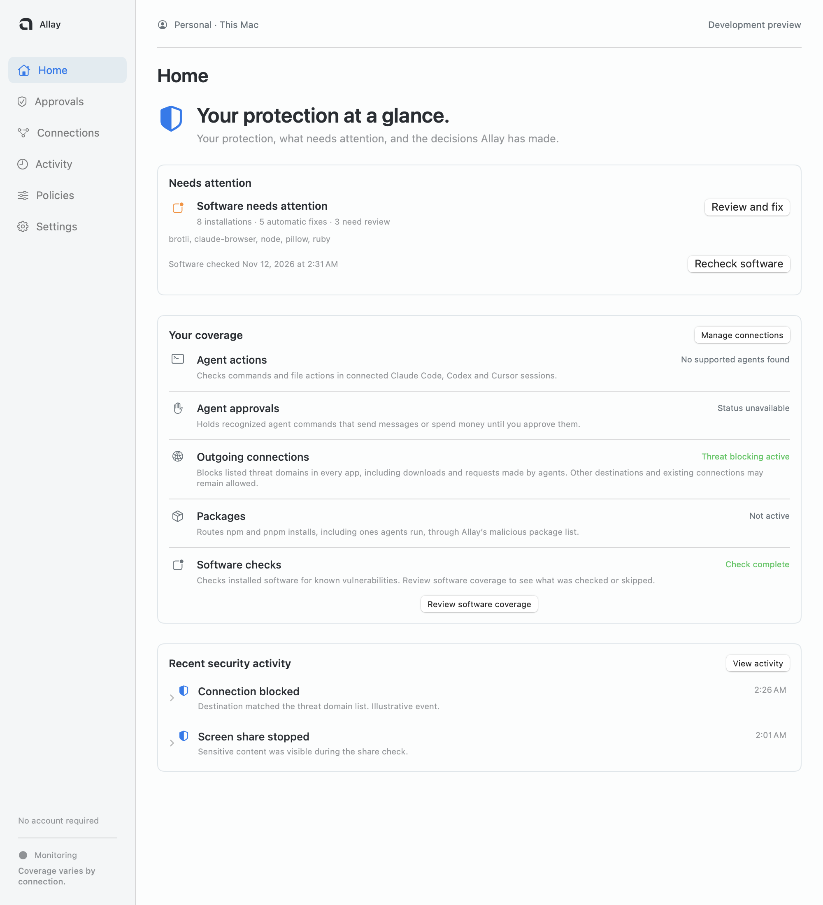

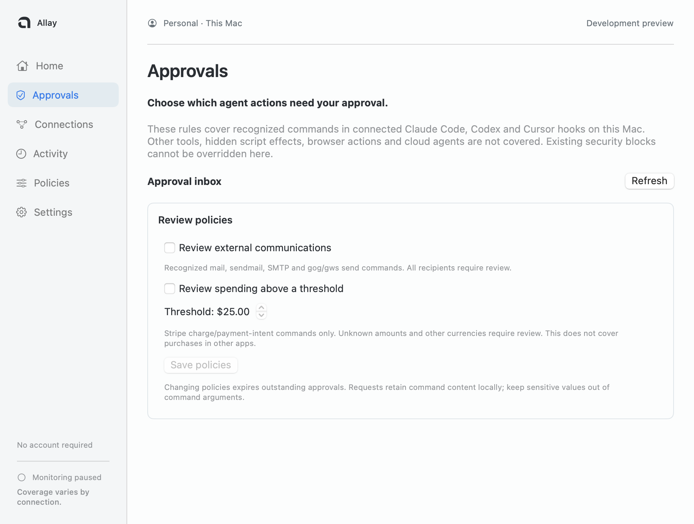

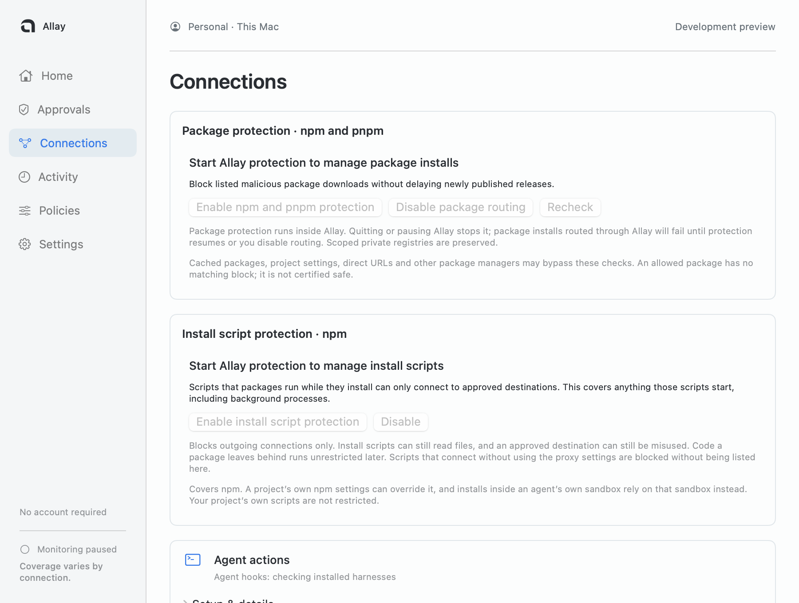

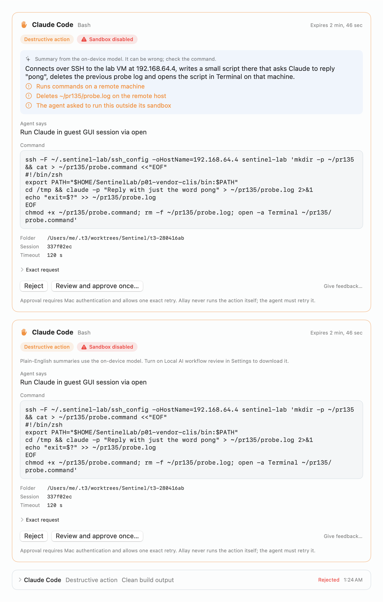

Three observations on the difference:

1. **Aikido's device app is a receipt printer, not a console.** Policy lives in the cloud dashboard, so the device has nothing to configure. Allay puts policy on the device, so some of its extra surface is inherent to "local first, no account".
2. **Much of Allay's surface is not inherent.** Home, Connections and Policies each carry paragraphs of scope caveats, disabled buttons and setup controls. Aikido answers "am I protected?" with one word; Allay's Home answers it with five rows in four different states.
3. **Aikido is too thin where it matters.** A blocked user learns "Malware" and a hash. There is no why, no source, no chain back to the agent, and no next step other than asking an admin. Allay's approval card already does better on all four.

## Against the plan in issue #149

### Where Aikido is ahead on things #149 wants

| #149 item | Aikido today | Allay today (per #149 and docs) |
| --- | --- | --- |
| Minimum release age (roadmap 2) | Shipped; suppresses versions in registry metadata | Not built |
| Ecosystem breadth (roadmap 2) | 15 ecosystems, including IDE and browser extensions and Skills.sh | npm and PyPI lists; npm/pnpm routing only |
| No per-tool routing | Network extension catches every client, including ones agents launch | Opt-in npm/pnpm routing; cached packages and other managers bypass |
| "Protected only when enforcing" (principle 5) | One pill, and `aikido-doctor status` names the missing step | Status spread across rows; wording varies by layer |
| Self-test | A "Test" button per ecosystem with a safe known-bad package | None in the app |
| Plaintext secrets (roadmap 5) | Shell-history secret scan with rewrite, flag-gated | Not built |
| MCP and agent discovery (roadmap 2) | Likely inventoried for the dashboard (inferred) | Not built |
| Diagnostics | One CLI covering status, events, certs, repair and support bundle | No equivalent single tool |

The self-test is cheap and worth copying outright: a harmless published
package that Allay's feed always blocks, and a button that shows the command.

### Gaps in Aikido that #149's thesis depends on

| #149 layer | What Aikido showed on the device |
| --- | --- |
| 1. Install gate | Strong. Reputation plus release age only; an unknown, old-enough package is allowed. |
| 2. Containment | Nothing. An allowed package's install script runs with full user access. |
| 3. Outbound control | Only the 12 registry hosts are inspected. No general per-app or threat-list blocking was seen. An admin-triggered "lockdown" exists but was not tested. |
| 4. Agent action checks | Nothing. No hooks, no held actions, no approval inbox. |
| 5. Machine health | Inventory is collected and sent to the cloud; nothing is shown to the user. |
| 6. Smart triage | Nothing on the device. `AiFeaturesEnabled` exists as a flag but was off; what it does is unknown. |

Other gaps that matter for #149's "individuals" audience:

- **No agent context.** The event names a node binary hash. It cannot say "Claude Code ran this", which #149 lists as the reason one app beats separate tools.
- **No local exception path.** The only route is "request" to an admin. A solo user with their own token has to go to the web dashboard.
- **Silent breakage.** Release-age suppression produced a confusing npm error with no notification, and broke Aikido's own test. This is the "protection applied blindly" failure #149's triage layer is meant to prevent.
- **Account and cloud required.** Token enrollment, and device identifiers and software inventory leave the machine. #149's "local first, no account, nothing uploaded by default" is a real difference.
- **Heavy trust footprint.** A root CA, TLS interception of package traffic, edits to shell profiles and git config, and up to 470 MB for the network extension. Allay's registry proxy needs none of that, at the cost of coverage.

### What this suggests for #149

1. **The "one app instead of six tools" claim needs care.** Aikido already is one app for layer 1 across 15 ecosystems. Allay's differentiator is layers 2 to 4 and 6 plus local-first, not the install gate.
2. **Minimum release age and wider ecosystem coverage are table stakes** for the install gate. Without them Allay loses the layer-1 comparison on a feature list.
3. **If Allay adds release age, pair it with an explanation at the point of failure.** Aikido's version shows what happens without one.
4. **Allay's UI should move toward Aikido's density for the default view** and keep its detail for the block itself: one status word, one list of events, and caveats moved out of the main pages into help.
5. **System-wide interception is the coverage/trust trade-off to decide deliberately.** Aikido covers every client by intercepting TLS. #149's Pipelock-style "optional strict mode with TLS inspection" would put Allay in the same position, with the same CA and dotfile costs.

## Reproducing

The VM is named `aikido-test` under Tart. `ssh -F ~/.tart-app/ssh_config
aikido-test` reaches it; the guest account is `admin` / `admin`. Inside the
guest, `sudo aikido-doctor status` and `sudo aikido-doctor events` show state.
