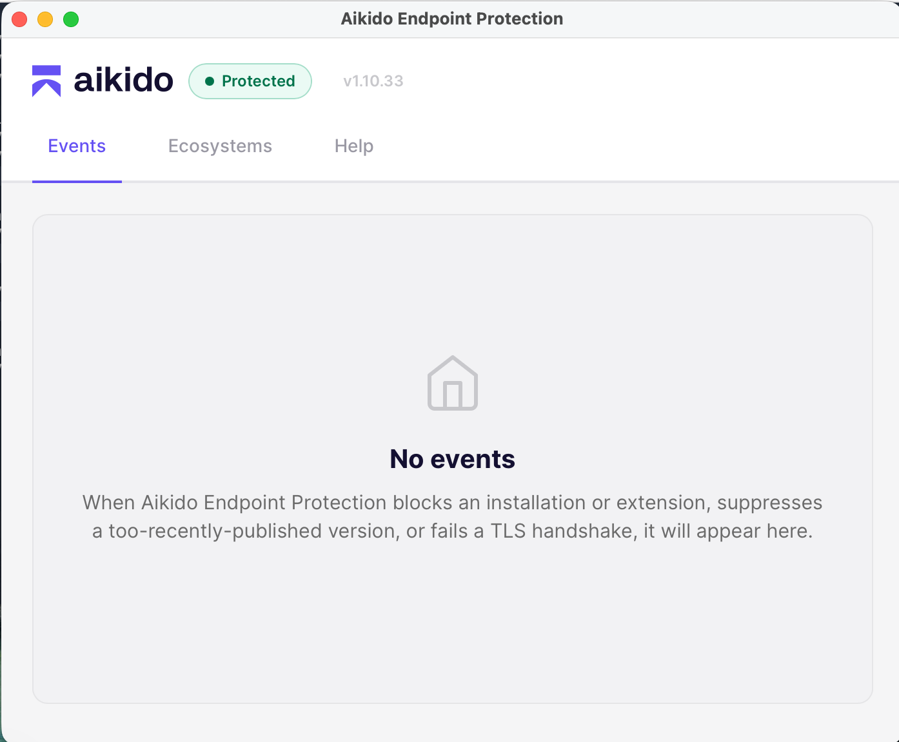
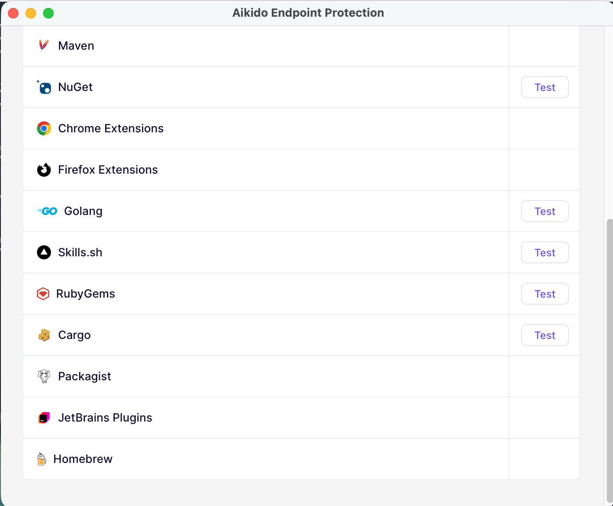
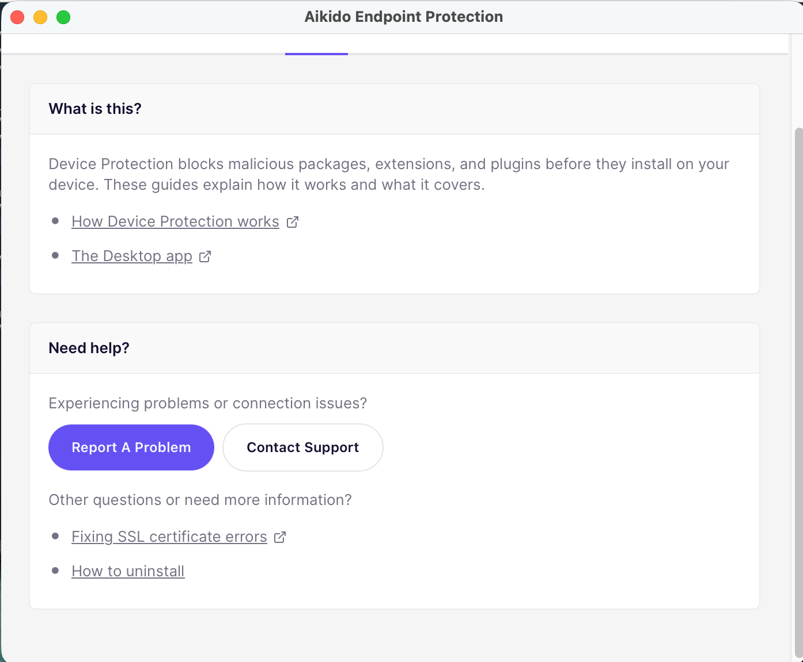
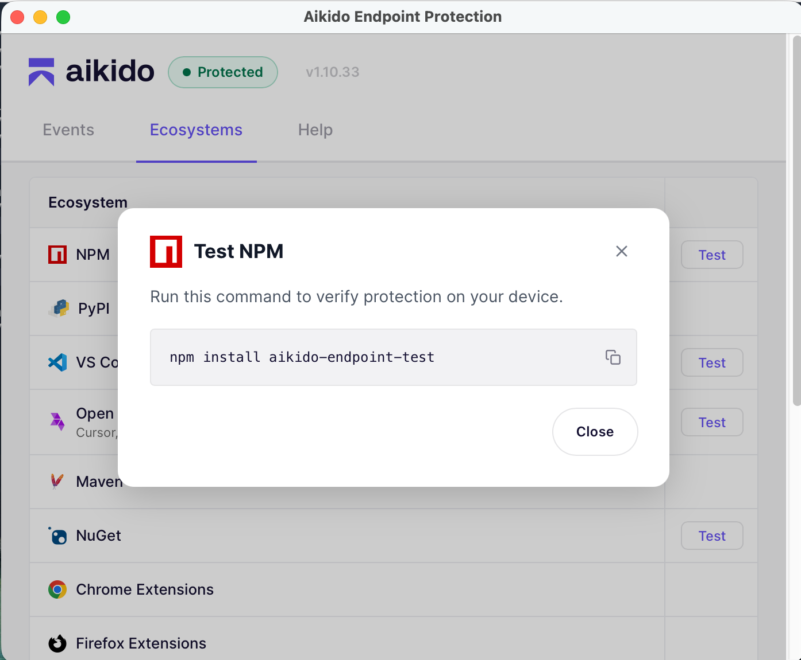
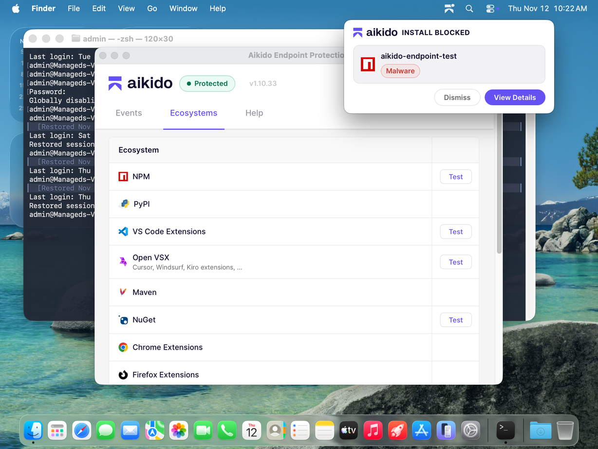
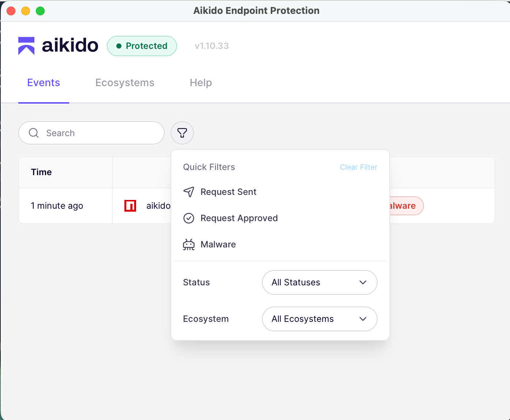
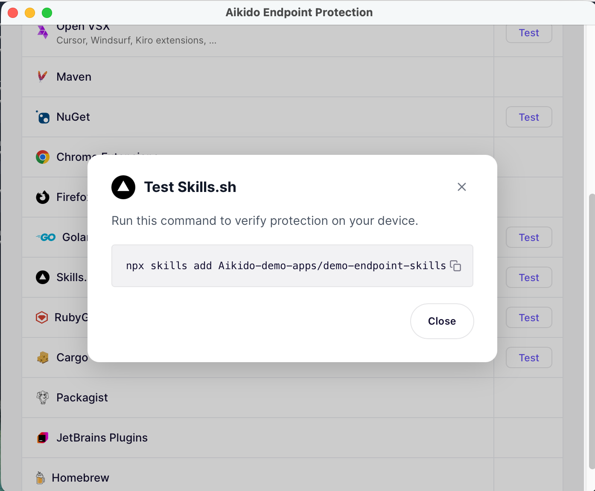

# Aikido Device Protection research

Historical evaluation notes from testing the macOS application.

## How this was tested

| Item | Value |
| --- | --- |
| Package | `EndpointProtection-1.10.33.pkg`, signed and notarized by Aikido Security (7VPF8GD6J4) |
| Guest | macOS 26.6.2 on Tart, image `ghcr.io/cirruslabs/macos-tahoe-base`, 4 CPU, 8 GB |
| Enrollment | Token staged in `/tmp/aikido_endpoint_token.txt`; server accepted it on first heartbeat |
| GUI capture | VNC over SSH into the guest; no host input events |

Limits of this test:

- **SIP is disabled** in the Cirrus Labs image. Enforcement behaviour on a stock Mac may differ.
- **The setup wizard was not captured.** It was completed by hand before screenshots started. Its step names come from the daemon log.
- **The cloud dashboard was not opened.** Everything below is the device side only.
- **Only npm was exercised.** Extension, browser, PyPI and other ecosystems were not triggered.
- **Two feature flags were off** for this account: `AiFeaturesEnabled` and `EnableSecretScanning`.
- Guest DNS had to be pointed at 1.1.1.1; the host's VM DNS forwarder did not answer. Not an Aikido issue.

## What the app looks like

The whole GUI is one window with three tabs, a menu bar icon with two items,
and one notification style.

### Window

| Tab | Contents |
| --- | --- |
| Events | Search box, filter button, table of Time / package / Status. Empty state is one sentence. |
| Ecosystems | Read-only list of 15 covered ecosystems; seven have a "Test" button that shows a command to copy. |
| Help | Two doc links, "Report A Problem", "Contact Support", SSL-error and uninstall links. |

The header carries the logo, a green "Protected" pill and the version. There is
no settings page, no toggle, no pause button, no policy view and no account
screen anywhere in the app.









Ecosystems listed: NPM, PyPI, VS Code Extensions, Open VSX (Cursor, Windsurf,
Kiro), Maven, NuGet, Chrome Extensions, Firefox Extensions, Golang, Skills.sh,
RubyGems, Cargo, Packagist, JetBrains Plugins, Homebrew.

### Menu bar

Two items: a status line ("Aikido Proxy: connected") and "Open Dashboard".


### A block, end to end

The NPM "Test" button shows `npm install aikido-endpoint-test`.



Running it produced three things:

1. npm failed with `403 Forbidden` on the tarball URL and npm's generic "forbidden by your security policy" text. Nothing in the terminal names Aikido.
2. A floating "INSTALL BLOCKED" card appeared top-right with the package name, a "Malware" tag, and Dismiss / View Details. It disappeared by itself within about ten seconds.
3. A row appeared in Events.




The detail view holds one sentence, the package and version, and an
"Application" field that reads `node-555549440a36…`: a binary hash, not the
terminal, agent or command that started the install.


The filter has quick filters for "Request Sent", "Request Approved" and
"Malware", plus status and ecosystem pickers. The first two belong to a flow
where a blocked user asks an admin for approval (`aikido-doctor request`).



### A minimum-age suppression, and a rough edge

The Skills.sh "Test" button shows `npx skills add Aikido-demo-apps/demo-endpoint-skills`.



Running it did not reach the skill check. npm failed first:

```
npm error code ETARGET
npm error notarget No matching version found for skills@1.8.1.
```

Aikido had hidden `skills` 1.8.0 and 1.8.1 under its minimum package age
policy, so `npm view skills` reported 1.7.6 as latest while npx still asked for
1.8.1. No notification was shown. The only trace is a grey "Versions
Suppressed" row in Events, and `aikido-doctor events` does not list it.


So the product's own test command for agent skills was broken by its own
release-age rule, with an npm error that does not mention Aikido. The age
threshold is not shown anywhere in the app.

## What sits under the small UI

Observed in the guest:

- **System-wide interception.** A network system extension diverts traffic for 12 registry hosts (`registry.npmjs.org`, `pypi.org`, `files.pythonhosted.org`, `crates.io`, `index.crates.io`, `rubygems.org`, `proxy.golang.org`, `repo1.maven.org`, `api.nuget.org`, `repo.packagist.org`, `marketplace.visualstudio.com`, `open-vsx.org`) to a local TLS-inspecting proxy. No per-package-manager routing is needed.
- **Its own CA, pushed into every toolchain.** It installs a CA in the system keychain and maintains 18 "certconfig" rules (node, npm, pip, uv, git, curl, ruby, cargo, java, homebrew, Firefox, Chromium and others) with automatic drift repair.
- **Edits to user dotfiles.** It appended CA environment variables (`SSL_CERT_FILE`, `CURL_CA_BUNDLE`, `PIP_CERT`, `REQUESTS_CA_BUNDLE` and more) to `~/.zshrc` and `~/.zprofile`, set `http.sslCAInfo` in `~/.gitconfig`, and wrote `~/.config/pip/pip.conf`. Backups are left as `*.aikido-backup`.
- **Reporting to Aikido.** Heartbeats include hostname, serial number, MAC address, user name and whether the user is an admin. A software inventory (Homebrew, npm and others) is collected and, per the CLI help, submitted to Aikido.
- **Footprint.** About 540 MB on disk. Resident memory: network extension 230 to 470 MB, UI 120 MB, daemon 40 MB.
- **A second extension** (Endpoint Security) is in the package but was not active; only the network extension was loaded.

Controls that exist only outside the GUI (`aikido-doctor`, see
[aikido-doctor-help.txt](aikido-doctor-help.txt)):

- `status` prints a clear "Protected / Not protected" checklist with the exact missing setup step.
- `pause --hours N` pauses protection; there is no pause in the app.
- `request` lists blocked packages and asks an admin to approve them. There is no local allow.
- `lockdown release` refers to a network lockdown an admin can trigger from the dashboard.
- `secretscanning` scans shell history with 463 rules and can rewrite history files; disabled by flag here.
- `sbom generate`, `certconfig`, `certs`, `diagnostics`, `device-identity`, `token`.

Inferred, not verified: strings in the daemon binary name collectors for Claude
Code, Claude Desktop, Codex and Cursor, and MCP server config. This suggests it
inventories agent installs and MCP servers for the dashboard. No such data
appeared in the device UI.
